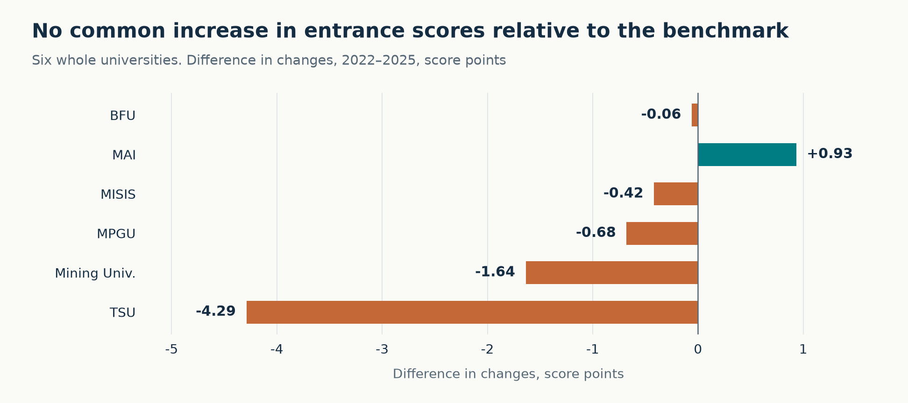
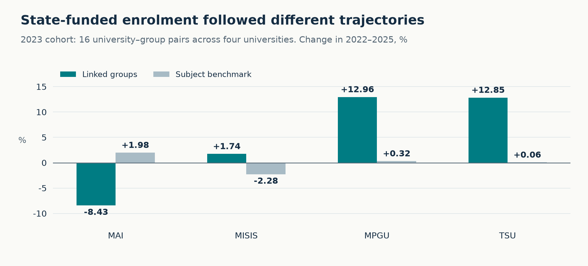
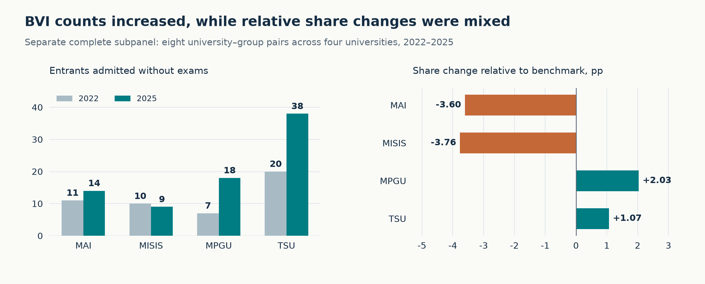

# Admissions to universities in Russia’s new higher education model pilot

[Русский](README.md) · **English**

A research project by **Vladislav Borisenko** for the 2026 HSE Higher Education Research Hackathon, Data Analysis track.

**Research question:** did the initial pilot universities become more attractive to prospective students?

The study examines state-funded admissions in 2021–2025: mean entrance scores, enrolment counts and admission without entrance examinations, referred to as **BVI** in the source data. Changes are compared with a subject benchmark and checked against alternative baselines and observation sets.

**Main finding:** the available indirect indicators do not provide robust evidence of a common increase in attractiveness. Enrolment expansion and isolated positive changes do not establish an overall increase in demand or a causal effect of the pilot.

## Data and scope

| Source | Use |
| --- | --- |
| Monitoring Quality of Admission — MKP | State-funded enrolment, mean entrance scores and BVI in 2021–2025 |
| University Performance Monitoring — MEV | University size and subject profile; pre-pilot description and comparability checks. Reporting years 2021–2024 |
| University documents | Historical verification of links between pilot programmes and MKP subject groups |

The university-level analysis covers the six initial participants: Immanuel Kant Baltic Federal University, Moscow Aviation Institute, MISIS, Moscow Pedagogical State University, Tomsk State University and Saint Petersburg Mining University.

The detailed 2023 cohort comprises **16 university–group pairs across four universities**: MAI, MISIS, MPGU and TSU. These are groups linked to the pilot, not 16 individual pilot programmes. Groups may also contain other programmes. BVI is analysed on a separate complete subpanel of eight pairs.

## Main findings

### Entrance scores across six universities



The chart shows the university’s score change minus the change in its subject benchmark. Group membership and 2022 enrolment weights are held fixed.

MAI has a positive contrast of **+0.93 score points**, BFU is close to zero and the other four universities have negative contrasts. MAI’s result changes sign with a 2021 baseline. A negative contrast describes relative change and does not necessarily mean that the university’s own score fell.

### Enrolment in linked groups



Enrolment in the main cohort increased from **2,963 to 3,082**, a gain of **119 students, or 4.02%**. The mean growth-rate contrast with the subject benchmark is **+4.76 percentage points**, giving each of the four universities equal weight.

Trajectories differ: MPGU and TSU expanded enrolment by approximately 13%, MISIS remained broadly stable and MAI contracted. These are changes in actual enrolment. They do not by themselves establish growth in applications or planned places.

### Admission without entrance examinations



In the separate BVI subpanel, the count increased from **48 to 79** and the share from **2.04% to 3.23%**. However, share-change contrasts with the benchmark are positive for MPGU and TSU and negative for MAI and MISIS.

An increase in absolute BVI counts therefore does not establish a common advantage. The chart presents both counts and relative changes so that large percentage increases do not conceal small initial numbers.

## Analytical approach

1. **Preparation and quality checks.** Parse text-based numbers, preserve missing values and check university–group–year keys and valid ranges.
2. **Fixed panels.** Hold observation sets constant across all five years for each metric separately. Missing values are not treated as zero.
3. **Subject benchmark.** Use the same subject groups at other universities, excluding all six initial participants. Align benchmark composition with the focal university’s baseline structure.
4. **Comparative changes.** Use fixed enrolment weights for scores, enrolment growth rates and changes in BVI shares. Also compare linked and other observed groups within universities and calculate linked groups’ enrolment shares.
5. **Sensitivity checks.** Change the baseline year and examine small initial BVI counts.

Key queries: [fixed panels](sql/04_fixed_panels.sql), [main comparisons](sql/05_main_comparisons.sql), [BVI analysis](sql/07_bvi.sql).

**Tools:** PostgreSQL, Python and Matplotlib. SQL uses CTEs, `CROSS JOIN LATERAL`, `FILTER`, the `LAG` window function and materialized views.

Early comparisons were performed in PostgreSQL; the final research checks were calculated in Python. The SQL implementation of the main final calculations was reconstructed later and checked locally against verified results. The full matching procedure has not yet been ported to this SQL section.

## Limits of interpretation

- MKP groups may combine pilot and other programmes; the exact proportion of pilot students is unknown.
- Enrolment also depends on the supply of places. Direct demand measurement requires comparable applications, applicant priorities and places.
- MKP assigns BVI entrants scores of 100, so scores and BVI cannot be treated as independent evidence.
- Only one pre-pilot interval is available. A causal effect is not established. Statistical significance was not assessed.

The absence of robust supporting evidence is not proof of no effect.

## Repository and reproduction

```text
sql/                    Preparation, checks and research queries
src/build_figures.py    Russian and English figure generation
assets/ru/              Figures for the Russian README
assets/en/              Figures for the English README
data/README.md          Local input specifications
requirements.txt        Visualization dependencies
```

Source datasets, the registry needed for reproduction and derived numerical tables are not distributed. The repository contains code and final figures. Full execution requires authorized access to the local data.

1. Prepare inputs according to the [data specifications](data/README.md), currently in Russian.
2. Follow the [SQL execution guide](sql/README.md), also in Russian. Tested with PostgreSQL 18.
3. To rebuild figures, create `outputs/chart_data`, run `sql/10_export_chart_data.psql` through psql from the repository root, then:

```bash
python -m pip install -r requirements.txt
python src/build_figures.py
```

Figures use local SQL exports, which are excluded from Git. The visualization script was tested with Python 3.12.

## Sources and acknowledgements

Data were provided by the [2026 HSE Higher Education Research Hackathon](https://educonf.hse.ru/2026/hackathon/). [Monitoring Quality of Admission](https://ege.hse.ru/) · [Methodology](https://ege.hse.ru/method) · [Subject classification](https://ege.hse.ru/groups).

These data were obtained from Monitoring Quality of Admission to Russian Universities by NRU HSE (http://ege.hse.ru/). The authors thank the Laboratory for University Development at the Institute of Education of the HSE University for providing a consolidated database of indicators for Monitoring the effectiveness of universities.
