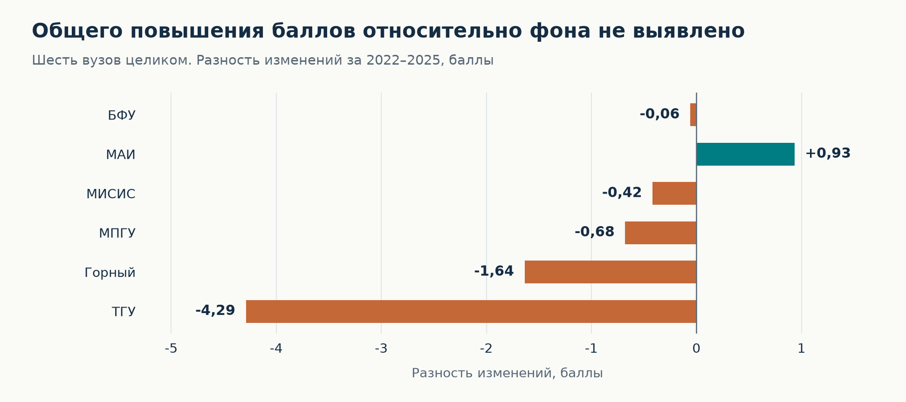
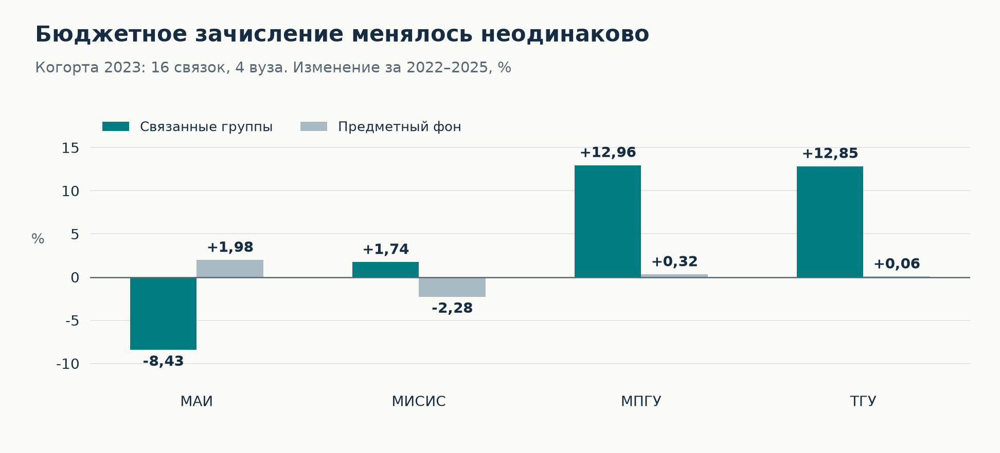
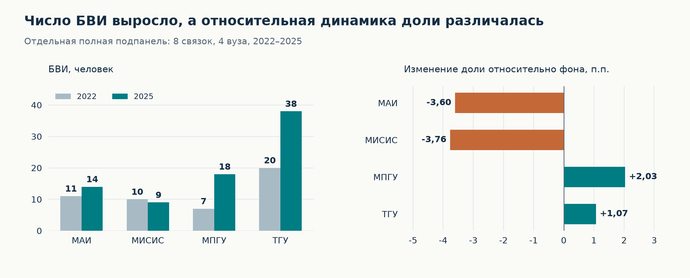

# Приём в вузы пилота новой модели высшего образования

**Русский** · [English](README.en.md)

Исследовательский проект **Борисенко Владислава** для хакатона исследователей высшего образования НИУ ВШЭ 2026, номинация «Анализ данных».

**Вопрос:** стали ли первоначальные участники пилота привлекательнее для абитуриентов?

Исследую бюджетный приём за 2021–2025 годы: средний вступительный балл, число зачисленных и поступление без вступительных испытаний — БВИ. Сравниваю изменения с предметным фоном и проверяю чувствительность результатов к выбору базы и состава наблюдений.

**Главный вывод:** устойчивого общего подтверждения повышения привлекательности по доступным косвенным показателям не обнаружено. Расширение зачисления и отдельные положительные изменения не позволяют установить общий рост спроса или причинный эффект пилота.

## Данные и охват

| Источник | Использование |
| --- | --- |
| Мониторинг качества приёма — МКП | Зачисление на бюджет, средний вступительный балл и БВИ за 2021–2025 годы |
| Мониторинг эффективности вузов — МЭВ | Размер и профиль вузов; описание и проверка сопоставимости до перехода. Отчётные 2021–2024 годы |
| Документы университетов | Историческое подтверждение связей пилотных программ с группами МКП |

Исходная панель МКП включает головные государственные вузы с данными о суммарном бюджетном и платном приёме во все пять лет. Постоянные группы по каждой метрике отбираются дополнительно.

На уровне вузов рассматриваю первоначальную шестёрку: БФУ им. И. Канта, МАИ, МИСИС, МПГУ, Томский государственный университет и Санкт-Петербургский горный университет.

Детальная когорта 2023 года включает **16 связок «вуз — группа» четырёх вузов**: МАИ, МИСИС, МПГУ и ТГУ. Это группы, связанные с пилотом, а не 16 отдельных пилотных программ. Внутри группы могут присутствовать и другие программы. Для БВИ используется отдельная полная подпанель из восьми связок.

## Основные результаты

### Баллы шести вузов



Показатель на графике — изменение балла вуза минус изменение соответствующего предметного фона. Состав наблюдений и веса **между группами** фиксированы на 2022 году. Внутри каждой группы фон использует текущие веса приёма контрольных вузов. Численность зачисления — приближение к неизвестному знаменателю официального среднего ЕГЭ.

При фиксации также весов контрольных вузов БФУ меняет знак: −0,06 → +0,26 балла; общий вывод для шестёрки сохраняется. [Все варианты, размеры панелей и охват приёма](docs/results.md).

У МАИ разность положительная — **+0,93 балла**, у БФУ близка к нулю, у остальных четырёх вузов отрицательная. При этом результат МАИ меняет знак при базе 2021 года. Отрицательное значение характеризует относительную динамику и не обязательно означает снижение собственного балла вуза.

### Зачисление в связанных группах



В основной когорте зачисление выросло с **2963 до 3082 человек**: **+119 человек, или +4,02%**. Средняя разность темпов роста с предметным фоном при равном весе четырёх вузов составляет **+4,76 п.п.**

Динамика неоднородна: МПГУ и ТГУ расширили набор примерно на 13%, МИСИС почти сохранил объём, МАИ сократил. Это изменение фактического зачисления. Само по себе оно не устанавливает рост заявлений или увеличение плановых мест.

### БВИ и состав зачисленных



В отдельной подпанели число БВИ выросло с **48 до 79**, доля — с **2,04% до 3,23%**. Однако относительно фона разность изменений доли положительная у МПГУ и ТГУ и отрицательная у МАИ и МИСИС.

Поэтому рост абсолютного числа БВИ не даёт общего подтверждения преимущества участников. На графике показаны и численности, и относительный результат: небольшой исходный набор не скрывается за большим процентным ростом.

## Как устроен анализ

1. **Подготовка и контроль качества.** Преобразование текстовых чисел, обработка пропусков, проверка ключей «вуз — группа — год» и допустимых значений.
2. **Постоянные панели.** Для каждой метрики сохраняется один состав наблюдений за все пять лет. Пропуск не заменяется нулём.
3. **Предметный фон.** Те же группы других головных государственных вузов исходной пятилетней панели МКП, за исключением всех шести первоначальных участников. Структура фона согласована с исходной структурой рассматриваемого вуза.
4. **Сопоставление изменений.** Фиксированные веса приёма для баллов, темпы зачисления и изменения долей БВИ. Дополнительно — связанные против остальных групп внутри вуза и доля связанных групп в приёме.
5. **Проверки устойчивости.** Смена базового года и диагностика малых исходных численностей.

Ключевые запросы: [формирование панелей](sql/04_fixed_panels.sql), [основные сравнения](sql/05_main_comparisons.sql), [анализ БВИ](sql/07_bvi.sql), [проверки аудита](sql/11_audit_sensitivity.sql).

**Инструменты:** PostgreSQL, Python, Matplotlib. В SQL используются CTE, `CROSS JOIN LATERAL`, `FILTER`, оконная функция `LAG` и материализованные представления.

Ранние сравнения выполнялись в PostgreSQL, итоговые проверки исследования — в Python. SQL для основных итоговых расчётов восстановлен позднее и локально сверен с проверенными результатами. Теперь основные расчёты независимо воспроизводит [Python-проверка](src/independent_check.py). Подбор ближайших аналогов по МЭВ не включён в публичный сценарий; устойчивость к такому подбору здесь не заявляется.

Численные результаты v5 воспроизведены в [отдельной проверке по исходным Excel](docs/independent_replication.md): 4191 сверка общего сценария и 214 дополнительных сравнений отдельным расчётом без использования расчётных функций проекта. Различие контрольных сумм МКП зафиксировано в протоколе; прежний отчёт авторского запуска сохранён.

## Границы выводов

- Группы МКП могут смешивать пилотные и другие программы; точная доля пилотных студентов неизвестна.
- Зачисление зависит и от предложения мест. Для прямой оценки спроса нужны сопоставимые заявления, приоритеты выбора и места.
- В методике МКП БВИ присваиваются 100 баллов, поэтому баллы и БВИ нельзя считать независимыми подтверждениями.
- Доступен один допилотный интервал. Причинный эффект не установлен. Статистическую значимость не оценивали.

Отсутствие устойчивого подтверждения не доказывает отсутствия эффекта.

## Структура и воспроизведение

```text
sql/                    Подготовка, проверки и исследовательские запросы
src/build_figures.py    Построение графиков на русском и английском
assets/ru/              Графики русской версии
assets/en/              Графики английской версии
metadata/               Реестр связок, источники, названия вузов и схема МЭВ
docs/                   Результаты проверок и инструкция воспроизведения
tests/                  Контрпримеры методики на искусственных данных
data/README.md          Описание локальных входных файлов
requirements.txt        Зависимости для визуализации
```

Исходные массивы и построчные производные таблицы не распространяются. [Реестр связок с источниками](metadata/scope_registry.json) и [сводные результаты проверок](docs/results.md) опубликованы. Репозиторий содержит код и итоговые графики. Полный запуск требует разрешённого доступа к локальным данным.

Для запуска нужны разрешённый доступ к исходным Excel хакатона, Python 3.12 и PostgreSQL 18 с клиентом psql. Используйте **новую отдельную базу**: сценарий не удаляет существующие таблицы и остановится, если схемы проекта уже заполнены.

```bash
python -m pip install -r requirements.txt
createdb hse_pilot_reproduction
python src/run_analysis.py --mkp /path/to/МКП.xlsx --mev /path/to/МЭВ.xlsx --dsn 'dbname=hse_pilot_reproduction user=postgres'
python src/build_figures.py
```

Сценарий создаёт каталоги, извлекает нужные поля из Excel, загружает реестр, выполняет SQL, проверяет состав панелей, сравнивает SQL с независимым Python и выгружает данные графиков. Для повторного запуска нужны новая база и новый пустой каталог `--output`; старые результаты не перезаписываются. При любой ошибке он останавливается. Пароль задаётся через `.pgpass`. На macOS psql при необходимости указывается флагом `--psql /Library/PostgreSQL/18/bin/psql`.

[Подробный запуск и проверки](docs/reproduction.md) · [Состав входов](data/README.md) · [Ответ на аудит](docs/audit_response.md).

Числовые выгрузки остаются в `outputs/` и исключены из Git. Контроль размеров относится к опубликованному составу исследования. Новая выборка требует осознанного изменения ожиданий и подписей. Для доступа к массивам обращаются к организаторам хакатона; репозиторий не предоставляет обход ограничений.

## Источники и благодарности

Данные предоставлены организаторами [хакатона ИВО 2026](https://educonf.hse.ru/2026/hackathon/). [Мониторинг качества приёма](https://ege.hse.ru/) · [Методика](https://ege.hse.ru/method) · [Классификатор групп](https://ege.hse.ru/groups).

В данной работе использованы данные исследования НИУ ВШЭ «Мониторинг качества приема» (http://ege.hse.ru/). Авторы благодарят сотрудников проектно-учебной лаборатории «Развитие университетов» Института образования НИУ ВШЭ за предоставление сводной базы показателей Мониторинга эффективности вузов.
